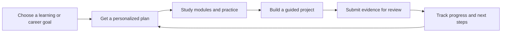
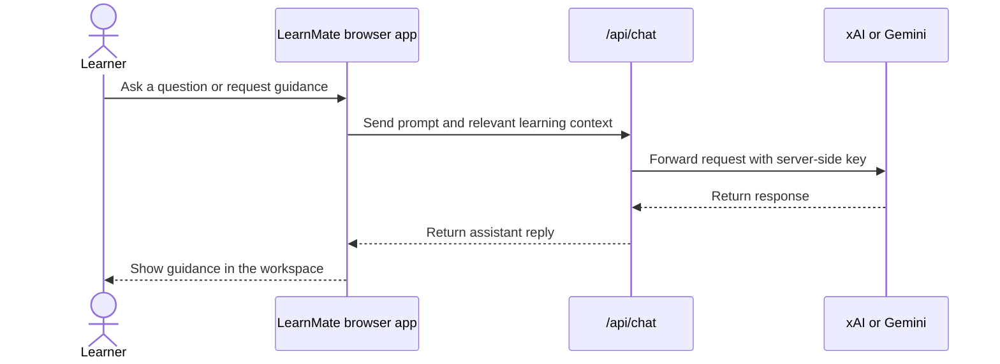

<div align="center">

# LearnMate AI

### Learn with intention. Build with confidence. Move toward your career.

**An AI-powered learning and career workspace that turns a personal goal into clear lessons, project steps, and practical next actions.**

[Open the live app](https://learnmate-ai-rose.vercel.app/) · [Explore the code](https://github.com/ayogitha10-sys/learnmate-ai)

<br>


</div>

---

## The idea

Learning tools are often scattered across separate apps. **LearnMate brings study, practice, projects, and career preparation into one responsive workspace.** Learners choose a goal, get a practical path forward, and track the work they complete along the way.

The experience is designed around a simple loop:

> **Choose a goal → learn a concept → practice it → build something → review your progress.**

## What you can do

| Workspace | What it helps with |
| --- | --- |
| **AI Assistant** | Ask questions, get explanations, and receive guidance tailored to your learning or career goal. Choose xAI Grok or Google Gemini as the server-side provider. |
| **Learn** | Create learning paths, work through modules, and reinforce concepts with quizzes and flashcards. |
| **Planner** | Turn a goal and timeline into a day-by-day roadmap with learning content, actions, and completion check-ins. |
| **Projects** | Generate a project-specific build plan. Work through one step at a time, submit evidence for AI review, unlock the next step, and ask project questions in context. |
| **Documents** | Add study material, review extracted content, and ask the assistant questions with a selected document as context. |
| **Interview Studio** | Practice interview rounds for a target role and job description, then review feedback on your answers. |
| **Career** | Build a roadmap around your selected career goal, skills, and activity. |
| **Resume Studio** | Edit a resume with a live preview and request AI feedback, including an estimated ATS match. |
| **Progress** | See activity-based progress, experience points, and earned badges across the workspace. |

The public landing page introduces the product with animated sections and responsive layouts. In-app pages include keyboard-aware controls, clear progress states, and readable feedback.

## Product flow



## Built with

- **Frontend:** HTML, CSS, and vanilla JavaScript
- **Local development:** Node.js built-in HTTP server; no frontend build step
- **AI:** xAI chat completions or Google Gemini, selected through environment variables
- **Authentication and cloud data:** Supabase Auth and project storage
- **Deployment:** Vercel, with the AI endpoint running as a serverless function
- **Browser storage:** Learning activity, plans, conversations, and workspace progress are saved locally in the browser

## Run locally

### Requirements

- Node.js 18 or newer
- An xAI API key or Google Gemini API key for live AI responses

### Start the app

```bash
git clone https://github.com/ayogitha10-sys/learnmate-ai.git
cd learnmate-ai
npm start
```

Open the local URL printed in the terminal, usually [`http://localhost:3000`](http://localhost:3000). Run the app through the server rather than opening `index.html` directly so `/api/chat` can handle AI requests.

### Configure AI

Copy `.env.example` to `.env`, then add the provider key you want to use:

```env
AI_PROVIDER=xai
XAI_API_KEY=your_xai_api_key
XAI_MODEL=grok-4.6
PORT=3000
```

To use Gemini instead:

```env
AI_PROVIDER=gemini
GEMINI_API_KEY=your_gemini_api_key
GEMINI_MODEL=gemini-2.5-flash
PORT=3000
```

Restart the server after changing `.env`. **Never commit `.env` or put a provider key in browser code.** The repository ignores `.env`; `.env.example` contains variable names only. Provider usage may incur charges under the provider’s current terms.

## Deploy to Vercel

1. Import the GitHub repository into Vercel.
2. Add `AI_PROVIDER` and the matching provider key (`XAI_API_KEY` or `GEMINI_API_KEY`) under the project’s Environment Variables. Add optional model variables if needed.
3. Deploy the project. Vercel serves the frontend and exposes `api/chat.js` as the AI endpoint.
4. For your own Supabase project, configure its project URL and publishable key in `supabase-auth.js`, and enable the required Auth and project-table policies in Supabase.

The production version of this project is available at [learnmate-ai-rose.vercel.app](https://learnmate-ai-rose.vercel.app/).

## How the app is structured

```text
.
├── index.html                 # App entry point and browser dependencies
├── styles.css                 # Responsive visual system and page styles
├── app.js                     # Core app state, navigation, and local server features
├── learnmate-upgrades.js      # Learning and interaction improvements
├── learnmate-engagement.js    # Progress, activity, and engagement features
├── learnmate-workspace.js     # Planner, project, career, and assistant workspaces
├── supabase-auth.js           # Supabase authentication and cloud data bridge
├── server.js                  # Local Node.js server and AI proxy
└── api/
    └── chat.js                # Vercel serverless AI endpoint
```

### Request flow



## Data and privacy notes

- Learning paths, planner progress, project steps, chats, and activity are stored in browser `localStorage` for the current browser profile.
- Supabase provides authentication and the configured cloud-backed profile/project features.
- AI provider keys belong in server environment variables. They are not required in the frontend.
- When a user asks about a document, relevant extracted content may be included in the AI request. Treat uploaded content as private and avoid sharing material you do not want sent to the configured AI provider.
- PDF and DOCX text extraction uses browser libraries loaded from CDNs; extraction availability depends on network access.

## Notes for contributors

This is a lightweight MVP built without a bundler or framework. Keep browser code free of secrets, preserve the local-server and Vercel AI routes, and check responsive layouts when changing shared styles.

---

<div align="center">

**LearnMate AI · Learn. Build. Grow.**

</div>
